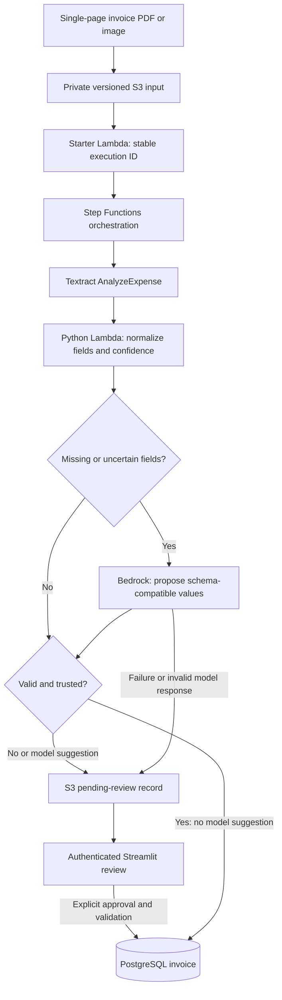
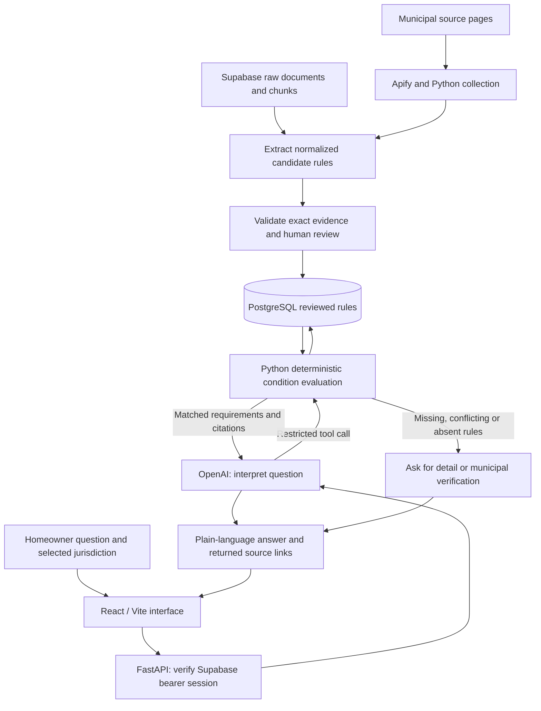
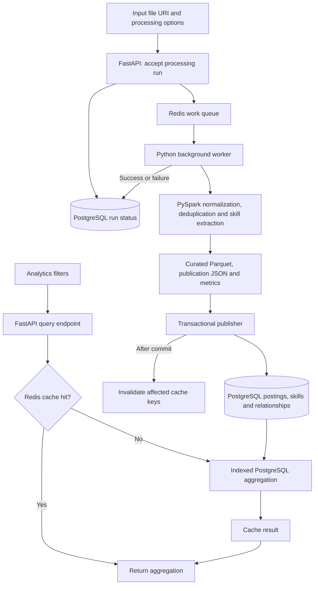

# Project system-design explainers

These public case studies explain the same implementation at two levels: a
plain-language story and a technical system map. The examples are illustrative;
they are not records of live customer transactions.

- [Job Posting Skill Demand Analyzer](https://danielberhane.vercel.app/en/work/tech-skill-demand-platform#architecture)
- [Paper-to-Digital Invoice Intelligence Platform](https://danielberhane.vercel.app/en/work/invoice-pipeline#architecture)
- [Homeowner Permit Compliance Checker](https://danielberhane.vercel.app/en/work/preclear-ai#architecture)

## How to present a project

1. Start with the person and problem, before naming technologies.
2. Follow one example through the numbered system map.
3. Explain what enters and leaves each component, and why that boundary exists.
4. Follow a failure or uncertainty branch; explain who makes the final decision.
5. Describe a tradeoff and what you would change at greater scale.
6. Separate tested implementation from cloud readiness and unverified résumé metrics.

## Invoice story

A scanned invoice contains information a person would otherwise type into an
accounting system. S3 stores the file; an event starts a Step Functions workflow.
Textract reads invoice fields. Python normalizes values and checks confidence.
Bedrock can propose values for missing or uncertain fields, but its suggestions
must be reviewed. Streamlit lets a reviewer correct and approve those values.
Only valid, sufficiently trusted or approved fields reach PostgreSQL.

The important design decision is the database boundary: extraction is not the
same as acceptance. Candidates stay in S3 until validation or human review.
CDK defines the AWS infrastructure. Cloud deployment and live provider checks
remain blocked by AWS permissions; the implementation has focused local tests.

## Permit story

A homeowner asks whether a project needs a permit. The assistant verifies their
Supabase session, then an OpenAI model interprets the question and calls a
restricted lookup tool. FastAPI evaluates project attributes against reviewed
PostgreSQL rules for the selected jurisdiction. It returns requirements and
sources, or requests more information or municipal verification.

A separate ingestion path uses Python and Apify, or existing Supabase documents,
to produce candidates that require source evidence and human review before
publication. The model explains retrieved rules; deterministic code evaluates
them. React/Vite provides the interface; Vercel hosts the interface and API.
The canonical source is Preclear/Preclear-Astra. Code is deployed, but live
session/data/model configuration and municipal source coverage are not verified.

## Job analytics story

Job advertisements express the same skills in different ways and often repeat
one another. FastAPI accepts a processing request, PostgreSQL records its status,
and Redis queues it for a Python worker. PySpark normalizes records, classifies
reposts and maps text to a versioned skill vocabulary. The publisher writes
queryable PostgreSQL tables and invalidates affected cache entries after commit.

A separate API request reads aggregated skill demand. Redis returns a cached
answer when possible; on a miss, PostgreSQL computes the result and Redis stores
it for subsequent requests. Queue and cache are separate roles, even though both
use Redis. Processing happens outside the interactive request lifecycle.
Existing results are development-fixture measurements, not proof of the larger
résumé dataset or production latency. Automatic worker retry/dead-letter handling
is a future improvement, not an implemented guarantee.

## Detailed reference maps

### Invoice: acceptance is separate from extraction

| Technology | Role | Why this boundary matters |
| --- | --- | --- |
| Python / Lambda | Short extraction, normalization and persistence tasks | Each stage has a specific responsibility |
| AWS CDK | Infrastructure definitions | Resources and permissions can be reviewed as code |
| S3 | Original documents and candidate/review artifacts | Unverified records stay outside the invoice database |
| Step Functions | Stage sequencing and error routing | Workflow progress is explicit |
| Textract | Invoice OCR and field extraction | Handles document reading before application validation |
| Bedrock | Suggest missing or uncertain values | Suggestions are not treated as verified facts |
| Streamlit | Human correction and approval | A reviewer controls acceptance of uncertain fields |
| PostgreSQL | Accepted normalized records | Parameterized writes and extraction IDs support safe persistence |

### Permit: source preparation and homeowner requests

| Technology | Role | Why this boundary matters |
| --- | --- | --- |
| Python / Apify | Collect and ingest municipal text | Collection is separate from user-facing lookup |
| PostgreSQL / Supabase | Rules, source documents and authentication | Reviewed rule publication is distinct from raw document storage |
| FastAPI | Validated, authenticated HTTP endpoints | A browser cannot directly invoke unrestricted database operations |
| OpenAI | Interpret questions and explain tool results | The model cannot issue permits or run arbitrary SQL |
| Python rule engine | Match compound conditions | Project eligibility is evaluated by explicit rules |
| React / TypeScript | Conversation and jurisdiction selection | User context is supplied explicitly |
| Vite | Frontend development and build tooling | Produces the browser application; it is not the API server |
| Vercel | Static frontend and Python function hosting | UI and API share the same application domain |

### Analytics: processing jobs and cached reads

| Technology | Role | Why this boundary matters |
| --- | --- | --- |
| Python | API services, worker and publication logic | Coordinates processing and persistence |
| PySpark | Normalize, deduplicate and match skill text | Batch computation stays outside interactive requests |
| FastAPI | Submit runs, poll status and request aggregations | Long-running work can return an accepted response immediately |
| PostgreSQL | Durable run status and normalized analytics tables | Queue delivery is not mistaken for durable job state |
| Redis queue | Hand work messages to the worker | Decouples request handling from processing |
| Redis cache | Reuse frequent aggregation results | A cache miss still reads the source-of-truth database |
| Docker / GitHub Actions | Reproducible services and automated checks | Supports repeatable development and validation |
